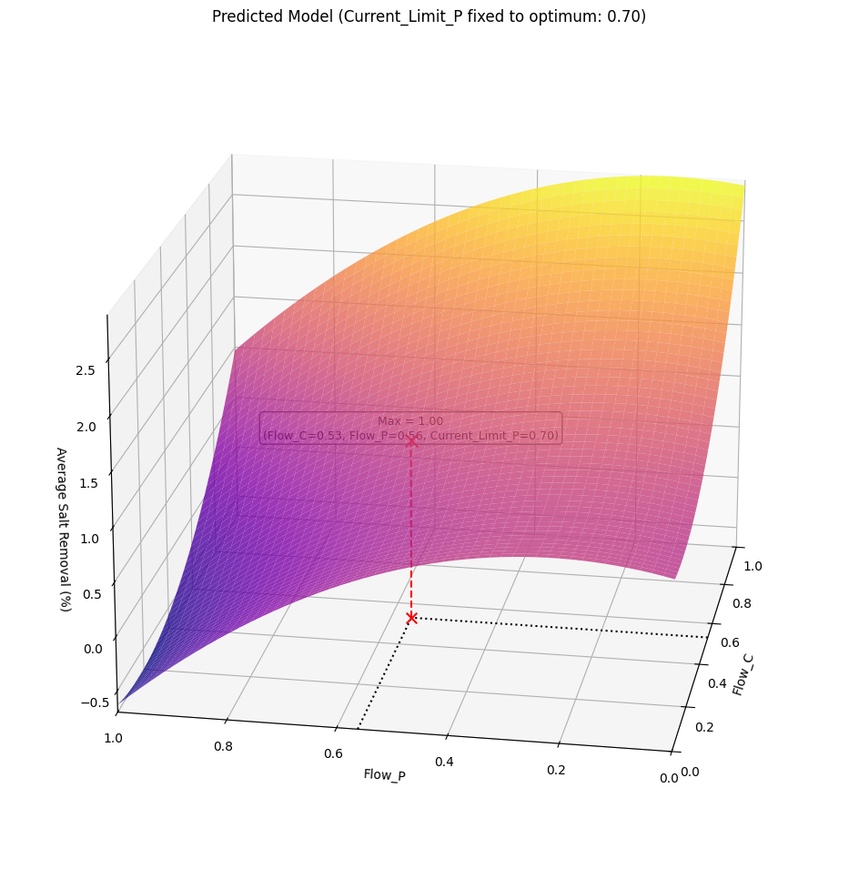

# Creation of a Data Model for Machine Learning using Sensor Data from a CO<sub>2</sub> Absorption Plant for Biogas

## Introduction

The data for this project comes from a facility belonging to the CapBioCO2 research project at Karlsruhe University of Applied Sciences. The aim of the facility is to absorb as much of the CO<sub>2</sub> contained in biogas as possible in order to increase the ecological sustainability of the biogas. In addition, the facility's process produces a salt solution as a by-product, which can be used for drinking water purification from fermentation residues.

The aim of this project is to first organize the collected data into a structure in which it can be further processed and evaluated. Since the underlying processes for the functioning of the facility are not easy to simulate, the next step is to perform modeling based on the pre-processed data. Based on the models, optimization methods will then be applied to find the best possible combination of adjustable input parameters so that the average percentage of salt removal is at its highest. Furthermore another aim is to maximize the average amount of purified water.

## Optimization Result

The following 3D visualization shows the maximum identified during the optimization:



## Project Setup

In order to set up the project properly, a few programs are necessary/recommended.

### Prerequisites

Installation of the following programs:

- [Git](https://git-scm.com/downloads/win)
- [Visual Studio Code](https://code.visualstudio.com/Download)
    - [Jupyter Extension](https://marketplace.visualstudio.com/items?itemName=ms-toolsai.jupyter)
    - [Python Extension](https://marketplace.visualstudio.com/items?itemName=ms-python.python)
- [Python](https://www.python.org/downloads/) (Version >=3.13)
- [Poetry](https://pypi.org/project/poetry/) (Version >=2.0.0)

### Initial Steps

To ensure that the jupyter notebooks can be executed properly, the following steps are recommended to set up the project:

1. Clone Git repository and direct into project folder.
    ```bash
    git clone https://github.com/DavidGinfo/CapBioCO2_Optimization
    ```

2. Create a virtualenv and activate it for current project.
    ```bash
    poetry env use py
    ```
    If you do not want to use the standard Python installation, you must specify a path to the desired Python interpreter instead of *py*.

3. Install python packages and dependencies.
    ```bash
    poetry install
    ```

4. Select python interpreter of virutalenv as global python interpreter for VSCode.

5. Select the same python interpreter as the Jupyter Notebooks kernel in every notebook. The interpreter of the virtualenv should be recommended automatically.


## Project Structure

```
├── cached_objects
│   ├── model_gbrt
│   ├── model_lin_reg
│   ├── model_random_forest
│   └── prepared_data
├── assets
│   └── maximum_3d.png
├── data
│   ├── processed
│   └── raw
├── notebooks
│   ├── modelling
│   ├── optimization
│   ├── preparation
│   └── suggestion
├── .gitignore
├── poetry.lock
├── pyproject.toml
└── README.md
```

All cached objects and Numpy data structures are stored in the `cached_objects` directory and there in the respective model subfolder. The original data (Excel spreadsheet) is stored under the path `data/raw` and the preprocessed data is then stored as CSV files in the folder `data/processed`. The Jupyter notebooks are divided into four subfolders and organized according to *models*, *optimization methods*, *data preprocessing*, and *measurement prediction*.

## User Guide

The project is generally divided into four sections, but their order is at least partially interdependent.

1. **Data Preprocessing**

    Here, the original data from the various test runs is processed into a format that can be reused in the next steps.

2. **Modeling**

    During modeling, the preprocessed data is used for a total of three different modeling approaches:
    - *Linear Regression:* Represent features as quadratic terms and calculate the coefficients using linear regression.
    - *Random Forest Regression*
    - *Gradient Boosting Regression (GBRT)*

3. **Optimization Methods**

    The primary optimization method used here is *extrema search* for the quadratic model. Another optimization method used here in a simplified form is *Bayesian Optimization*.

4. **Approach for Input Value Prediction**

    This section is independent of the previous two steps and is intended to use *Bayesian Optimization* to predict a measured value that can be used in the next experiment to better approximate the objective function.
